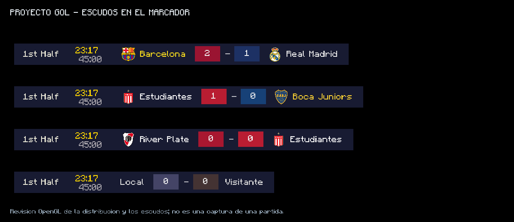
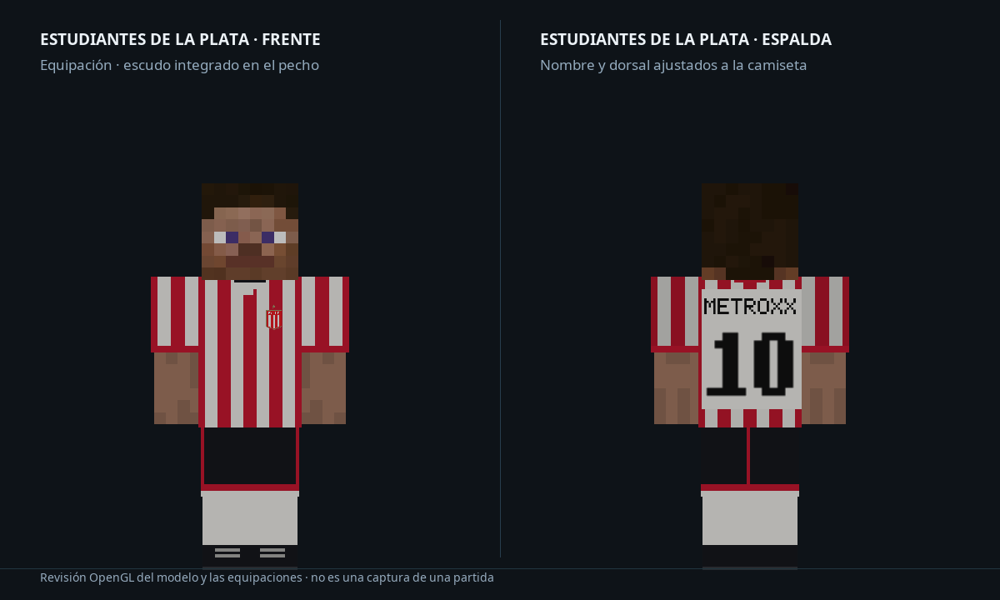

# Proyecto Gol 1.6.3-test2 — escudos en el marcador y Estudiantes

> Sustituida por [TEST3](ESTUDIANTES-1.6.3-test3.md), que conserva este uniforme y marcador y restaura el pase/regate de 1.6.2.

Nueva prueba basada en **1.6.3-test1 de conducción y recepción** (`4072f86`). Se publica en la rama `test-1.6.3-estudiantes`; la oficial continúa siendo **1.6.2** y no se modifica su rama principal.

[Descargar ProyectoGol-1.6.3-test2-estudiantes.jar](https://github.com/lestermessipro/Proyecto-gol/raw/refs/heads/test-1.6.3-estudiantes/ProyectoGol-1.6.3-test2-estudiantes.jar)

## Marcador

- El marcador del partido muestra los escudos de Barcelona, Real Madrid, Boca Juniors, River Plate y Estudiantes de La Plata junto a sus nombres.
- Utiliza las mismas imágenes empaquetadas que el pecho de las camisetas. El servidor envía la identidad de la equipación por separado del nombre visible, de modo que renombrar un equipo no cambia su escudo.
- Los nombres, escudos y resultados tienen espacios separados. La escala se ajusta al ancho de la interfaz para evitar que el marcador se corte en pantallas pequeñas.
- Un equipo desconocido se muestra sin escudo. Al desconectarse se limpian también las identidades de los escudos del marcador.

## Estudiantes de La Plata

- Equipo nuevo en el selector de equipos del partido, con sus colores e identificación de equipación.
- Camiseta nueva de rayas verticales rojas y blancas, pantalón negro y medias blancas, con un diseño clásico sin atribuirlo a una temporada concreta.
- Escudo al pecho, nombre y dorsal negros sobre un panel blanco en la espalda. Se usa el sistema de dorsales existente.
- Camiseta y pantalón como objetos de equipación, con sus iconos de inventario, modelos y traducciones. Compatible con los modelos de brazos normales y finos.

Puedes seleccionarlo desde los ajustes del partido. El comando de operador equivalente para el lado A es `/match team select A estudiantes`; para el lado B, `/match team select B estudiantes`.

Las texturas anteriores, incluida la de River suministrada por el usuario, siguen idénticas. Se conservan los índices anteriores de equipaciones y la conducción y recepción de TEST1; las clases de física del balón, interpolación, modelo articulado y registro de dorsales no cambian.

## Validación

- Compilación, reobfuscación e integridad del JAR correctas; **135 pruebas JUnit**, sin fallos ni pruebas omitidas.
- Pruebas de identificación del escudo con nombres personalizados, lectura del marcador anterior sin los campos nuevos, distribución del marcador y ajuste a interfaces de 200 a 640 píxeles de ancho.
- Revisión OpenGL de los cinco escudos dentro de sus espacios, cuatro ejemplos de marcador y vistas de frente y espalda del uniforme en ambos modelos de brazos. Sin errores OpenGL en la revisión del marcador.
- Las 38 imágenes PNG anteriores coinciden con TEST1. Resultados en [Revision-estudiantes-test2.json](Revision-estudiantes-test2.json).

**Pendiente:** comprobar una partida real y el registro y equipamiento del nuevo equipo en un servidor dedicado. Las imágenes anteriores son revisiones OpenGL, no capturas de una partida.

## Instalación

Reemplaza el JAR de Proyecto Gol por este **en cliente y servidor**, manteniendo Minecraft 1.12.2, Forge, Player API y Render Player API. Carga una sola versión del mod. El menú de mods debe mostrar **1.6.3-test2**. Las versiones anteriores no contienen los objetos nuevos de Estudiantes.

[Cambios-estudiantes-test2.patch](Cambios-estudiantes-test2.patch) recoge las modificaciones incrementales respecto a las fuentes recuperadas de TEST1. Incluye el generador de las cuatro texturas e iconos nuevos; las imágenes finales están empaquetadas en el JAR. El escudo de Estudiantes procede de [ESPN, equipo 8](https://a.espncdn.com/i/teamlogos/soccer/500/8.png), pertenece al club y se incluye sin modificar sus píxeles.

SHA-256 del JAR: `842fe3ec33f8902f21995899fc6778fe9297138a763dd97f3bc383eab2c6bf02`.
