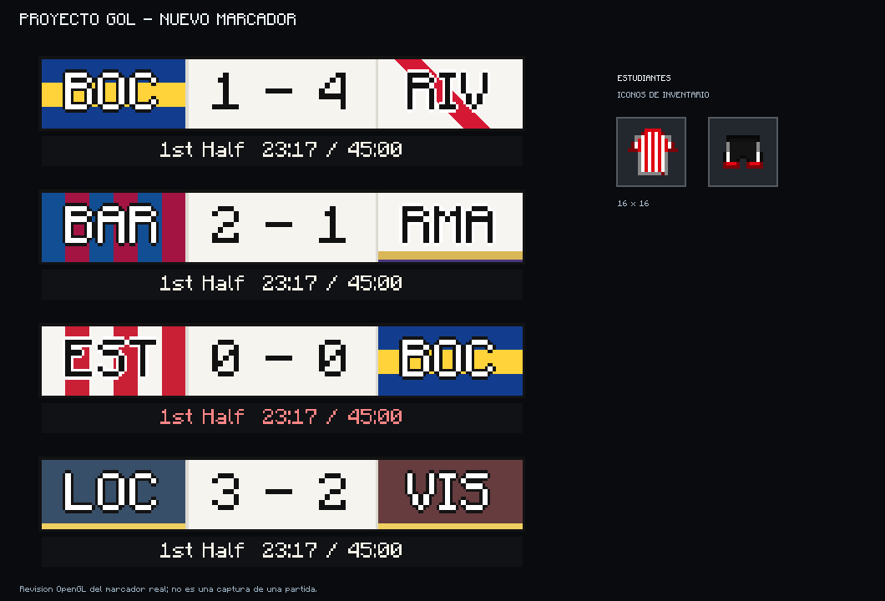

# Proyecto Gol 1.6.3-test4 — marcador e iconos de Estudiantes

Nueva prueba basada en TEST3. Conserva el **pase/regate y las animaciones de 1.6.2**, y cambia el aspecto del marcador y los iconos de inventario de Estudiantes. La oficial sigue siendo 1.6.2.

[Descargar ProyectoGol-1.6.3-test4-marcador.jar](https://github.com/lestermessipro/Proyecto-gol/raw/refs/heads/test-1.6.3-estudiantes/ProyectoGol-1.6.3-test4-marcador.jar)

## Marcador

Se adopta la distribución de la referencia: **abreviatura del local, resultado central sobre blanco y abreviatura del visitante**. Las letras son grandes y tienen contorno para distinguirlas del fondo. Se retiran los escudos del marcador; los escudos del pecho de las camisetas se mantienen.

| Equipo | Abreviatura | Fondo |
| --- | --- | --- |
| Boca Juniors | BOC | Azul con franja amarilla horizontal |
| River Plate | RIV | Blanco con banda roja diagonal |
| Barcelona | BAR | Franjas azules y granates |
| Real Madrid | RMA | Blanco con remate dorado y violeta |
| Estudiantes de La Plata | EST | Franjas rojas y blancas |

El reloj, la duración y el periodo se conservan en una tira pequeña debajo. Los equipos personalizados usan tres caracteres y sus colores recibidos del servidor. La anchura central se adapta a resultados largos y el conjunto se ajusta al ancho de la interfaz.

## Iconos de Estudiantes

La camiseta y el pantalón pasan de **32×32 a 16×16**, con el mismo contorno y escala de los iconos clásicos del resto de equipaciones. La camiseta conserva las rayas rojas y blancas; el pantalón usa el sprite clásico negro con detalles rojos y blancos. Se mantiene la transparencia sin bordes suavizados.

Las texturas del uniforme vestido, el modelo articulado, los escudos al pecho, los nombres y los dorsales no cambian. El generador del uniforme ya no vuelve a escribir los antiguos iconos de 32×32.

## Validación

- Compilación y reobfuscación correctas; **125 pruebas JUnit**, sin fallos ni pruebas omitidas.
- Se verifican los cinco estilos, abreviaturas, nombres personalizados, ajuste a pantallas pequeñas, resultados largos y las siluetas y transparencia de ambos iconos de 16×16.
- Revisión OpenGL del renderizador que usa el HUD: cinco fondos, cuatro ejemplos de marcador y los dos iconos. Incluye el **BOC 1–4 RIV** de la referencia. Sin errores OpenGL ni imágenes de escudos en el marcador.
- Las **17 clases de fútbol, entrada y animación comprobadas coinciden byte por byte con 1.6.2**. Las clases del uniforme vestido y las 41 imágenes anteriores ajenas a los dos iconos modificados coinciden con TEST3.

Detalle en [Revision-marcador-test4.json](Revision-marcador-test4.json). [Cambios-marcador-test4.patch](Cambios-marcador-test4.patch) recoge el cambio incremental de las fuentes recuperadas de TEST3; las imágenes finales están incluidas en el JAR.

La vista anterior es una revisión OpenGL del renderizador, no una captura de una partida. Falta la comprobación dentro del juego y en un servidor dedicado.

## Instalación

Sustituye el JAR anterior de Proyecto Gol por este **en cliente y servidor**, manteniendo Minecraft 1.12.2, Forge, Player API y Render Player API. Carga una sola versión. El menú de mods debe mostrar **1.6.3-test4**.

SHA-256: `0562c0fb54cdf1c5a63eccec5d235f541e8c7afe05ba18357610c4d39fcb7e6c`.
