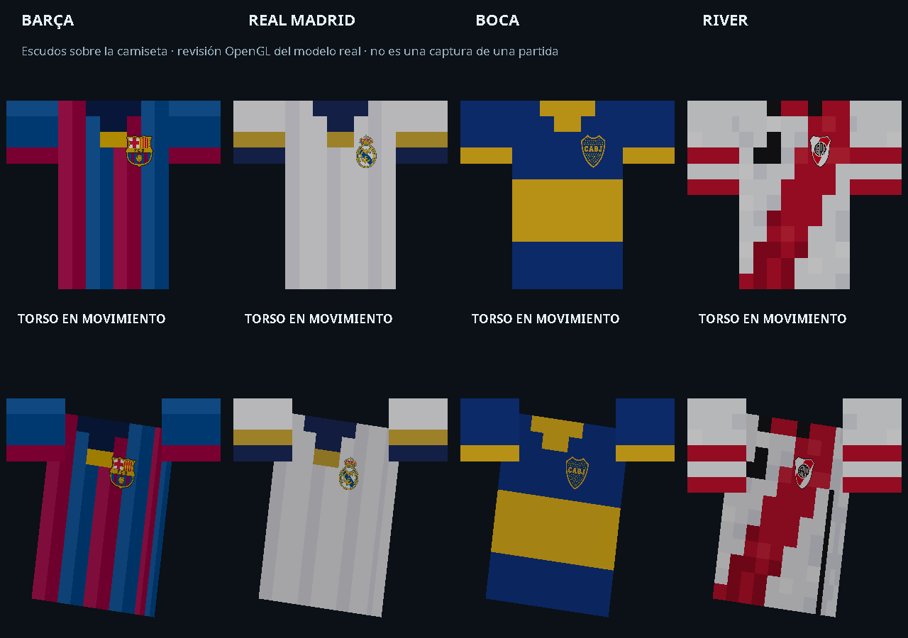

# Proyecto Gol 1.6.2 oficial

La versión **1.6.2** convierte TEST1 en la base oficial, conserva sus correcciones y optimizaciones y añade escudos al pecho de las equipaciones. Publicada en `main`, con la etiqueta `v1.6.2`. TEST1 y los JAR anteriores siguen disponibles.

[Descargar ProyectoGol-1.6.2.jar](https://github.com/lestermessipro/Proyecto-gol/raw/refs/tags/v1.6.2/ProyectoGol-1.6.2.jar)

## Escudos

- Barça, Real Madrid, Boca Juniors y River Plate llevan su propio escudo en el lado izquierdo del pecho.
- El escudo se dibuja como una impresión independiente sobre la tela, siguiendo el giro y la inclinación del torso y conservando la iluminación de la camiseta.
- Se selecciona por la camiseta equipada. Aparece sin necesidad de asignar un dorsal y cambia al cambiar de camiseta. La equipación del árbitro no lleva escudo de club.
- Las imágenes están incluidas en el JAR: no se descargan durante el juego. Sus recursos están en `assets/sports/textures/crests/{barcelona,realmadrid,boca,river}.png` y pueden sustituirse mediante un paquete de recursos.

Las texturas de las equipaciones, incluida la de River suministrada por el usuario, permanecen idénticas. También se mantienen el sistema y el renderizado de dorsales, las animaciones y las mejoras de TEST1 en HUD, resistencia, opciones, red y balón lowpoly.

## Validación

- Compilación y reobfuscación correctas; **110 pruebas JUnit**, sin fallos ni pruebas omitidas.
- Revisión OpenGL: **24 comprobaciones de visibilidad frontal**, **24 de oclusión desde la espalda** y **24 de conservación del estado de renderizado**, con cuatro clubes, tres poses y ambos modelos de brazos. Sin errores OpenGL. Resultados en [Revision-escudos-1.6.2.json](Revision-escudos-1.6.2.json).
- Se verificó que las clases existentes del JAR coinciden con TEST1, salvo la versión y la llamada que añade el escudo al modelo de camiseta. Se añade la clase del escudo y sus cuatro imágenes.
- Falta comprobar los nuevos escudos dentro de una partida real y con un servidor dedicado. La imagen anterior procede del modelo real en OpenGL, no de una partida.

[Cambios-1.6.2.patch](Cambios-1.6.2.patch) contiene el cambio incremental de código respecto a las fuentes recuperadas de TEST1; los PNG están empaquetados en el JAR. [TEST1-1.6.2.md](TEST1-1.6.2.md) conserva el detalle de las correcciones anteriores.

## Instalación

Sustituye el JAR anterior de Proyecto Gol en `mods` por `ProyectoGol-1.6.2.jar`. Mantén Minecraft 1.12.2, Forge, Player API y Render Player API. Carga una sola versión de Proyecto Gol. En multijugador, actualiza cliente y servidor. El menú de mods debe mostrar **1.6.2**.

SHA-256: `beadb2e3a5945d7a350ecadf1bad1730da191d4f22a08fb71662a9e8f4adffd8`.

## Procedencia de las imágenes

Escudos de los respectivos clubes, obtenidos del catálogo de equipos de ESPN. Se incluyen sin modificar sus píxeles; su tamaño sobre el pecho se controla en el renderizado.

| Equipación | Imagen de origen |
| --- | --- |
| Barcelona | https://a.espncdn.com/i/teamlogos/soccer/500/83.png |
| Real Madrid | https://a.espncdn.com/i/teamlogos/soccer/500/86.png |
| Boca Juniors | https://a.espncdn.com/i/teamlogos/soccer/500/5.png |
| River Plate | https://a.espncdn.com/i/teamlogos/soccer/500/16.png |
